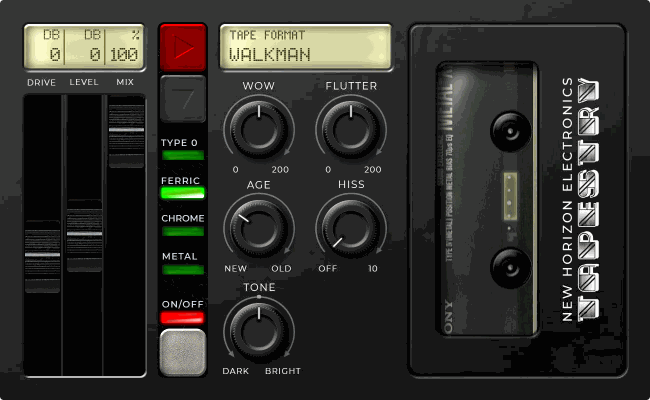

# Tapestry

**From first idea to final touches**

Whether it's that quick memo-recorder take of a great idea, or your final polished master ready to ship, New Horizon Electronics Tapestry adds as much or as little colour as you want. Nine tape machines and four tape formulations in one pedal, for MOD Duo, Duo X and Dwarf.



## A whole shelf of tape

Pick the machine, then pick what's on the reels. A mastering deck you can leave on all night, the bedroom 4-track your first demos lived on, the 8-track in your uncle's car, or the answering machine that kept the message you never deleted. Each one wobbles, saturates and fades in its own way, because each one is built from how that machine actually worked.

## Why it sounds like nothing else

Most tape plugins model one good machine. Tapestry models the mechanisms, so the odd ones get just as much care as the classics:

- **Obscure formats, full character.** The 8-track lurches, because its endless loop drags out of the centre of the reel. The 4-track breathes: its noise reduction hides the hiss in silence and lets it creep back in under your playing. The answering machine squeezes you down a phone line, and its auto level control pumps.
- **Mix and match the impossible.** Any tape on any machine. Metal tape on a dictaphone. Bargain-bin ferric on a 30 ips mastering deck. Combinations no one could ever buy.
- **The wobble comes from the hardware.** Wow and flutter are built from each machine's capstan, reels, belts and motor, at the rates their geometry sets. A mastering deck barely moves; a pocket recorder never sits still.
- **Tape physics, not a filter.** Hot treble wipes itself off the tape first, so your pick attack smooths out while the body stays full. Every format gets its own head bump, the low end tape is loved for.
- **It ages.** Stretched belts, worn heads and thin oxide: more wobble, a duller top and the odd dropout.
- **Clean by default.** Hiss starts at zero. Bring it in when you want it, at each format's real noise floor.

## Controls

| Control | How to use it |
| --- | --- |
| **Format** (red button) | Steps through the machines. The LCD names it and the window shows it. See the shelf below |
| **Tape** (grey button) | Steps through Type 0 (cheap), Ferric, Chrome and Metal. Or tap a label to jump straight to it. Cheaper tape saturates sooner, sounds duller and drops out more; Metal takes the most level and stays brightest |
| **Drive** (slider) | Recording level, −12 to +18 dB. Push it for glue, compression and saturation. It's mostly level-matched: full Drive is only about 4.5 dB louder |
| **Level** (slider) | Output, −12 to +12 dB. Match bypass, or push the amp |
| **Mix** (slider) | Dry to tape. The dry is delayed to match the tape, so blends don't comb |
| **Wow** | The slow, seasick drift: 0 to 200 % of the machine's own |
| **Flutter** | The fast shimmer: 0 to 200 % of the machine's own |
| **Age** | New to old. Belts stretch, heads wear, the top end dulls and dropouts creep in |
| **Hiss** | Off to 10. At 5 you hear the format's real noise floor; 10 is 10 dB more |
| **Tone** | A tilt around 800 Hz: dark to the left, bright to the right, flat at the top |
| **On/Off** | Bypass, click-free; the dry passes at unity. The red light shows it's on |

The LCDs show Drive, Level and Mix in dB and %, and the machine's name. Drag a slider or press anywhere along its channel.

### The shelf

| Format | What it's like |
| --- | --- |
| **Studio reel** | 15 ips half-inch: steady, open, a gentle bump at 70 Hz |
| **Home reel** | 7½ ips quarter-inch: warmer, a fatter bump, a little more drift |
| **Walkman** | Cassette at 1⅞ ips: the classic wobble and soft top end |
| **VHS** | The linear audio track: muddy, steep at the top, wobbly |
| **Pocket record.** | Microcassette dictaphone: no lows, no highs, auto level pumping |
| **Answer machine** | Microcassette down a phone line: the narrowest, most squeezed of all |
| **Master reel** | 30 ips mastering deck: near flat, rock steady. The always-on one |
| **8-track** | The endless loop: lurching wow, a fat 60 Hz bump, a dull top |
| **4-track** | A double-speed cassette multitrack with noise reduction: bright, quiet in the gaps, breathing when you play |

Mono in, mono out. The tape adds 6 ms of latency (the wobble needs room to swing both ways). Changing Format or Tape mutes for about 40 ms while the machine swaps, so it never clicks.

## Factory presets

| Preset | Sound |
| --- | --- |
| **Always on** | Master reel with a little Drive. Glue, not grit: leave it on all night |
| **Walkman, cheap tape** | The mixtape from the petrol station: wobbly, dull, a bit worn |
| **Walkman, chrome** | The good tape: brighter and steadier |
| **Studio half-inch** | Driven into a 15 ips reel for warmth and weight |
| **Home reel-to-reel** | The 1970s living-room deck |
| **Pocket dictaphone** | That quick memo take of a great idea |
| **Answering machine** | Leave a message after the tone |
| **VHS linear** | The sound of a rented tape |
| **8-track cartridge** | Road trip, back seat, worn out |
| **Bedroom 4-track** | Chrome tape, pushed hard: where the first demos were made |

## Install

**Test builds:** upload `nhe-tapestry.mk` to <https://builder.mod.audio/buildroot> with your MOD connected over USB, then click Install. The recipe is built into `dist/` by the test gate (below).

**MOD Plugin Store:** not yet.

## Build from source

Built with the [MOD plugin playbook](https://github.com/Kiwooky/MOD-plugin-playbook). With the playbook checked out next to this repo:

```sh
../MOD-plugin-playbook/tools/check.sh --src plugins/nhe-tapestry --bundle bundle/nhe-tapestry.lv2 --test tests/test_nhe_tapestry.py
# builds native, Duo and Duo X/Dwarf, checks the TTL, runs the tests, writes dist/nhe-tapestry.mk
```

The design, the formats' numbers and what's been measured: [SPEC.md](SPEC.md). What changed: [CHANGELOG.md](CHANGELOG.md).

## Repository layout

| Path | Contents |
| --- | --- |
| `plugins/nhe-tapestry/` | DSP source (C++, DPF) |
| `bundle/nhe-tapestry.lv2/` | LV2 metadata, factory presets, pedal face (template, CSS, script, images, LCD font) |
| `tests/` | Audio test suite |
| `dist/` | The single-file recipe for MOD's builder (generated) |

## Licence

Code: GPL-3.0-or-later. Artwork: © New Horizon Electronics ([ARTWORK-LICENSE.md](ARTWORK-LICENSE.md)).

The LCD font is "lcd phone" by Raúl Pérez Canseco (Grafito Design, dibujosenlinea.com.mx), with minus, plus and full stop glyphs added and the character set cut down for the LCDs.
